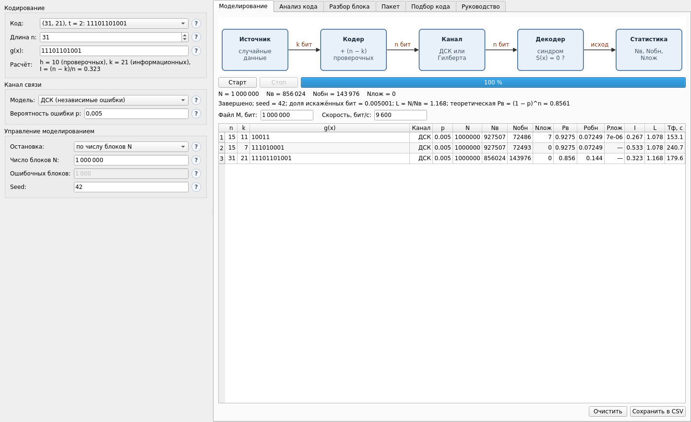
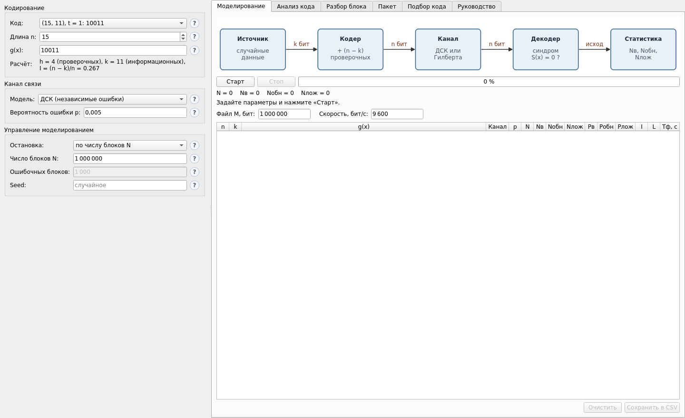

# crcsim

Программа для исследования циклических кодов (CRC) в режиме обнаружения ошибок. Она кодирует случайные блоки выбранным образующим многочленом g(x), пропускает их через модель канала — двоичный симметричный канал (ДСК) или канал Гилберта с пачками ошибок — и проверяет синдром на приёме. По результатам моделирования программа оценивает вероятности верного приёма Pв, обнаружения ошибки Pобн и ложного приёма Pлож. Если событие ни разу не наблюдалось, вместо нуля выводится прочерк «—» с верхней 95 %-й оценкой по «правилу трёх»: P < 3/N.



## Возможности

- консольная версия с интерактивным и пакетным режимами и графическая версия на Qt 6;
- коды длиной n от 3 до 64, многочлен g(x) задаётся двоичной строкой `10011` или списком степеней `[4;1;0]`;
- встроенная таблица образующих многочленов для n = 7, 15, 31, 63;
- две модели канала: ДСК и канал Гилберта;
- остановка по числу блоков или по числу ошибочных блоков, воспроизводимость через seed;
- оценки Pв, Pобн, Pлож, избыточность I, среднее число попыток L, распределение числа искажённых бит в блоке;
- сохранение результатов в CSV;
- скрипты исследования на Python с таблицами и графиками.

## Параметры

| Группа | Параметры |
|---|---|
| Кодирование | длина кодового слова n, образующий многочлен g(x) |
| Канал связи | тип канала; для ДСК — вероятность ошибки на бит p; для канала Гилберта — P_ХП, P_ПХ, p_П, p_Х |
| Управление моделированием | число блоков N, число ошибочных блоков для остановки, seed |

<details>
<summary>Окно с параметрами по умолчанию</summary>



</details>

## Скачать

Готовые сборки для Linux и Windows опубликованы на странице [Releases](https://github.com/AxellorWave/crcsim/releases/latest):

| Система | Архив |
|---|---|
| Linux x86_64 | `crcsim-linux-x86_64.tar.gz` |
| Windows x86_64 | `crcsim-windows-x86_64.zip` |

## Сборка из исходников

Нужен компилятор с поддержкой C++17, `make` и `pkg-config`; для графической версии — Qt 6 Widgets, для тестов — Boost.Test, для графиков исследования — matplotlib.

### Linux и WSL

```sh
sudo apt install g++ make pkg-config qt6-base-dev libboost-test-dev python3-matplotlib
```

### Windows (MSYS2 UCRT64)

```sh
pacman -S make mingw-w64-ucrt-x86_64-gcc mingw-w64-ucrt-x86_64-pkgconf mingw-w64-ucrt-x86_64-qt6-base mingw-w64-ucrt-x86_64-boost
```

### Цели make

| Команда | Результат |
|---|---|
| `make` | консольная версия `build/crcsim` |
| `make gui` | графическая версия `build/crcsim-gui` |
| `make test` | сборка и запуск тестов `build/crcsim_tests` |
| `make research-tools` | консольная версия и `build/weight_enumerator` для исследования |
| `make clean` | удаление каталога `build` |

## Консольная версия

Без аргументов `build/crcsim` запускается в интерактивном режиме и запрашивает параметры по очереди. С аргументами работает в пакетном режиме:

```text
Кодирование:
  --n ЧИСЛО                   длина кодового слова, 3..64 (по умолчанию 15)
  --g МНОГОЧЛЕН               g(x): 10011 или [4;1;0] (по умолчанию 10011)
Канал связи:
  --channel bsc|gilbert       тип канала (по умолчанию bsc)
  --p ЧИСЛО                   ДСК: вероятность ошибки на бит, (0; 0.5] (0.005)
  --p-gb ЧИСЛО                Гилберт: P_ХП, (0; 1) (0.001)
  --p-bg ЧИСЛО                Гилберт: P_ПХ, (0; 1) (0.1)
  --p-bad ЧИСЛО               Гилберт: p_П, (0; 0.5] (0.5)
  --p-good ЧИСЛО              Гилберт: p_Х, [0; 0.5] (0)
Управление моделированием:
  --blocks ЧИСЛО              число блоков N, 1..10^9 (1000000);
                              вместе с --errors — предельное число блоков
  --errors ЧИСЛО              остановка после заданного числа ошибочных блоков
  --seed ЧИСЛО                начальное значение генератора (0 — случайное)
Вывод:
  --csv ФАЙЛ                  дописать строку результата в файл CSV
  --csv-stdout                вывести на экран только CSV (заголовок и строку)
  --quiet                     не показывать ход моделирования
  --list-codes                вывести таблицу образующих многочленов (n;k;t;g)
  --help                      эта справка
```

Код (15, 11) на ДСК, результат в формате CSV:

```console
$ build/crcsim --n 15 --g 10011 --p 0.005 --blocks 3000000 --seed 42 --csv-stdout
n;k;g;channel;p;N;Nv;Nobn;Nlozh;Pv;Pobn;Plozh;I
15;11;10011;BSC;0.005;3000000;2782365;217615;20;0.9275;0.07254;6.667e-06;0.267
```

Код (63, 51) при тех же условиях: ложных приёмов нет, поэтому вместо Pлож стоит прочерк:

```console
$ build/crcsim --n 63 --g 1010100111001 --p 0.005 --blocks 3000000 --seed 42 --csv-stdout
n;k;g;channel;p;N;Nv;Nobn;Nlozh;Pv;Pobn;Plozh;I
63;51;1010100111001;BSC;0.005;3000000;2187885;812115;0;0.7293;0.2707;-;0.19
```

Код (31, 16) на канале Гилберта с параметрами по умолчанию:

```console
$ build/crcsim --channel gilbert --n 31 --g 1000111110101111 --blocks 1000000 --seed 7 --quiet
Результаты (n = 31, k = 16, g(x) = 1000111110101111, канал Гилберта, p = 0.00495, seed = 7):
  Передано блоков N                      1000000
  Принято верно Nв                        965193   P = 9.652e-01
  Ошибка обнаружена Nобн                   34807   P = 3.481e-02
  Ложный приём Nлож                            0   P = —  (не наблюдалось; P < 3.0e-06 с доверием 95 %)
  Измеренная доля ошибочных бит          0.00493
  Избыточность I = (n-k)/n                 0.484
  Среднее число попыток L = N/Nв           1.036
```

После этого программа печатает распределение числа искажённых бит в блоке.

### Формат CSV

Разделитель — «;», дробная часть отделяется точкой, тип канала записывается как `BSC` или `Gilbert`, прочерк — как `-`:

```text
n;k;g;channel;p;N;Nv;Nobn;Nlozh;Pv;Pobn;Plozh;I
```

## Исследование

Исследованы все 17 кодов таблицы (n = 7, 15, 31, 63) на ДСК при p = 0,05; 0,01; 0,005 и на канале Гилберта при P_ХП = 0,003; 0,001; 0,0005 (P_ПХ = 0,1, p_П = 0,5, p_Х = 0). На каждую точку — 3·10⁶ блоков, пограничные точки повторены с 3·10⁷ блоков. Требование: верхняя 95 %-я граница Pлож не выше 10⁻⁶. Время передачи файла Tф посчитано для M = 10⁶ бит при скорости 9600 бит/с.


Лучшие коды, удовлетворяющие требованию (`research/results/best_overall.csv`):

| Канал | Лучший по избыточности | Лучший по времени передачи |
|---|---|---|
| ДСК, p = 0,05 | (63, 45), I = 0,286 | (15, 5), Tф = 674,1 с |
| ДСК, p = 0,01 | (63, 51), I = 0,19 | (31, 21), Tф = 210,0 с |
| ДСК, p = 0,005 | (63, 51), I = 0,19 | (63, 51), Tф = 176,4 с |
| Гилберт, P_ХП = 0,003 | (63, 45), I = 0,286 | (63, 45), Tф = 177,1 с |
| Гилберт, P_ХП = 0,001 | (63, 45), I = 0,286 | (63, 45), Tф = 155,6 с |
| Гилберт, P_ХП = 0,0005 | (63, 45), I = 0,286 | (63, 45), Tф = 150,6 с |

Канал Гилберта при той же средней вероятности ошибки требует больше проверочных бит: для n = 15 требование не выполнил ни один код таблицы, для n = 31 нужен код (31, 16) с h = 15, для n = 63 — (63, 45) с h = 18. На ДСК при p = 0,005 достаточно h = 8 для n = 15, h = 10 для n = 31 и h = 12 для n = 63 (`research/results/best_per_length.csv`). При сильных помехах (p = 0,05) длинный блок приходится передавать в среднем 25 раз, поэтому по времени выигрывает короткий код (15, 5).

Воспроизвести результаты:

```sh
make research-tools
python3 research/run_research.py
python3 research/analyze.py
```

Исходные данные сохраняются в `research/data`, таблицы и графики — в `research/results`.

## Тесты

Тесты на Boost.Test покрывают арифметику многочленов, кодер и декодер, модели каналов, разбор параметров, оценки вероятностей и моделирование:

```sh
make test
```

## Структура проекта

```text
crcsim/
├── core/        ядро: многочлены, кодер, декодер, каналы, моделирование, оценки, CSV
├── console/     консольная версия: разбор аргументов, интерактивный режим, отчёт
├── gui/         графическая версия на Qt 6 Widgets
├── tests/       модульные тесты на Boost.Test
├── research/    скрипты исследования, исходные данные и результаты
├── docs/        отчёт, рисунки и скрипты сборки отчёта
└── Makefile
```

## Документация

Полное описание программы, её устройства и результатов исследования — в отчёте [docs/report.pdf](docs/report.pdf).
