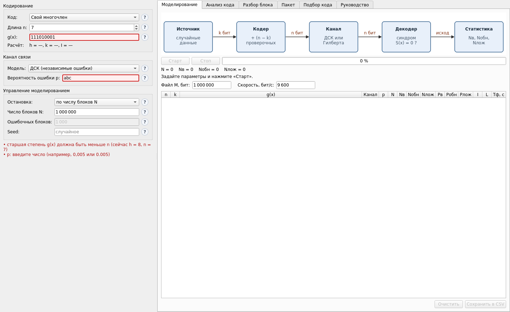
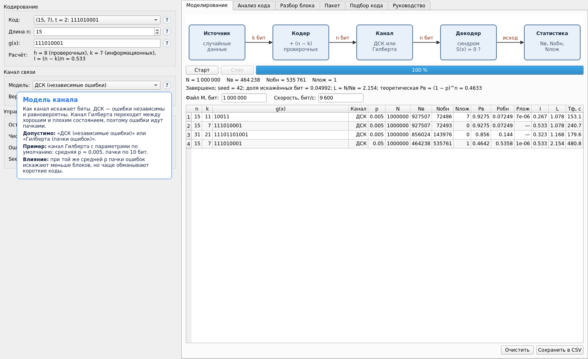
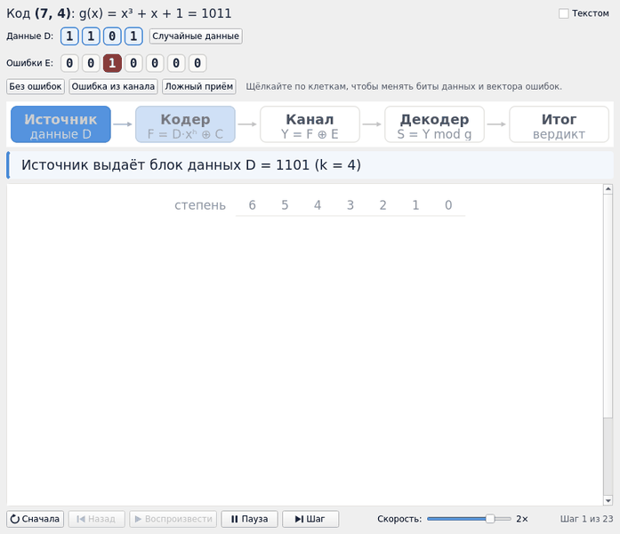
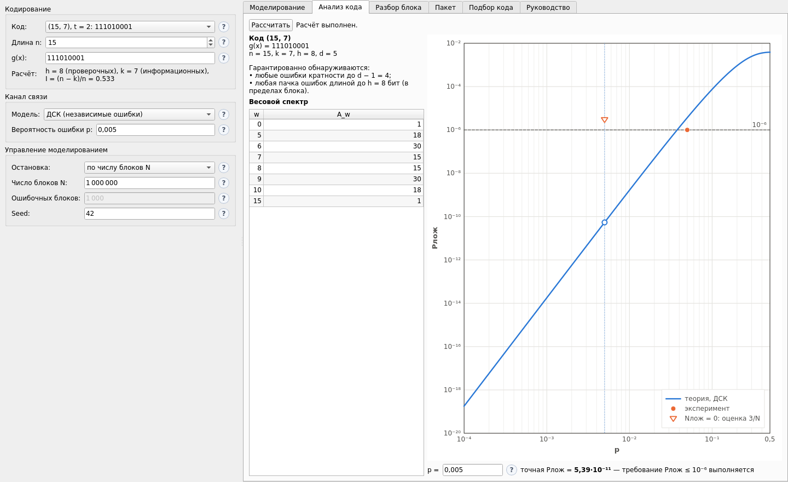
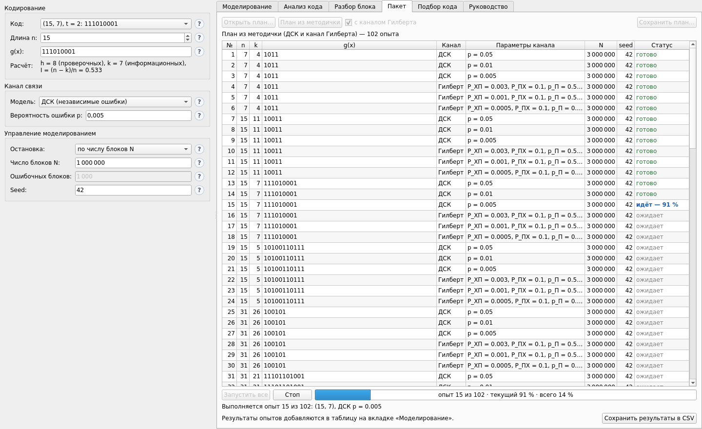
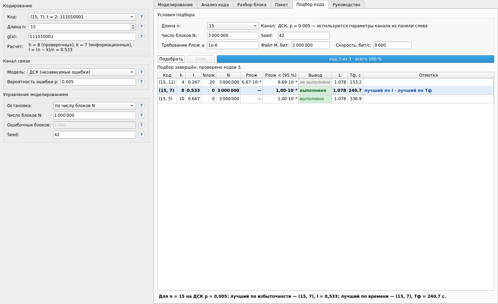
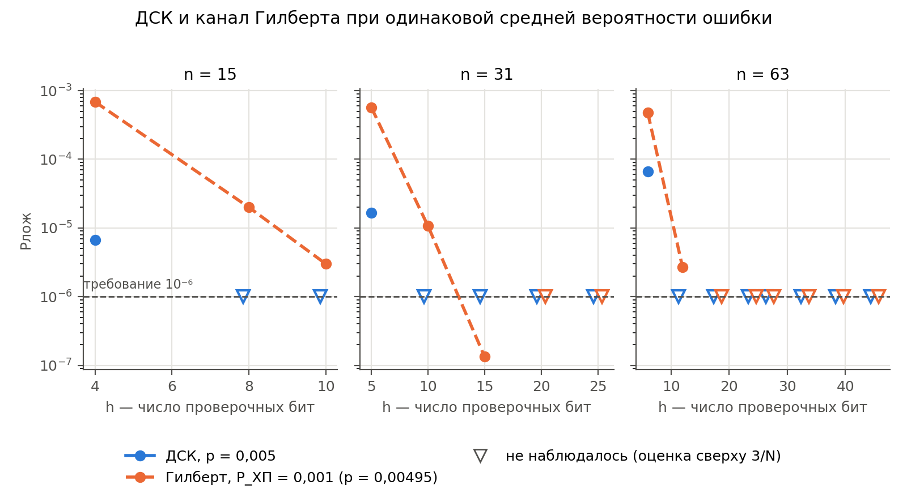

<div align="center">

# crcsim

**Исследование циклических кодов (CRC) в режиме обнаружения ошибок**

ДСК и канал Гилберта · анимированный разбор блока · анализ кода · пакетные опыты · подбор кода · Windows и Linux

<a href="https://github.com/AxellorWave/crcsim/releases/latest"></a>

  <a href="https://github.com/AxellorWave/crcsim/releases/latest/download/crcsim-gui.exe"></a>
  <a href="https://github.com/AxellorWave/crcsim/releases/latest/download/crcsim-setup.exe"></a>
  <a href="https://github.com/AxellorWave/crcsim/releases/latest/download/crcsim-gui-x86_64.AppImage"></a>
  <a href="https://github.com/AxellorWave/crcsim/releases/latest"></a>

<br><br>


</div>

---

## Содержание

- [Руководство пользователя](#руководство-пользователя)
  - [Установка](#установка)
  - [Первый опыт](#первый-опыт)
  - [Параметры](#параметры)
  - [Подсказки и встроенное руководство](#подсказки-и-встроенное-руководство)
  - [Как читать результаты](#как-читать-результаты)
  - [Разбор блока](#разбор-блока)
  - [Анализ кода](#анализ-кода)
  - [Сохранение в CSV](#сохранение-в-csv)
  - [Время передачи файла](#время-передачи-файла)
  - [Пакетная обработка](#пакетная-обработка)
  - [Подбор кода](#подбор-кода)
  - [Консольная версия](#консольная-версия)
- [Результаты исследования](#результаты-исследования)
- [Сборка из исходников](#сборка-из-исходников)
- [Документация](#документация)

## Руководство пользователя

Программа передаёт по модели канала связи случайные блоки данных, защищённые циклическим кодом, и считает, сколько блоков дошло верно, в скольких декодер обнаружил ошибку и сколько раз ошибка прошла незамеченной (ложный приём). Так можно сравнить коды и выбрать подходящий для заданного уровня помех.

### Установка

| Система | Что скачать | Как запустить |
|---|---|---|
| Windows 10/11 | [`crcsim-gui.exe`](https://github.com/AxellorWave/crcsim/releases/latest/download/crcsim-gui.exe) | запустить файл — установка не нужна |
| Windows 10/11 | [`crcsim-setup.exe`](https://github.com/AxellorWave/crcsim/releases/latest/download/crcsim-setup.exe) | установщик: ярлык в меню «Пуск», удаление через «Приложения» |
| Linux x86_64 | [`crcsim-gui-x86_64.AppImage`](https://github.com/AxellorWave/crcsim/releases/latest/download/crcsim-gui-x86_64.AppImage) | `chmod +x crcsim-gui-x86_64.AppImage`, затем запустить |
| Консоль | [`crcsim.exe`](https://github.com/AxellorWave/crcsim/releases/latest/download/crcsim.exe) · [`crcsim-linux-x86_64.tar.gz`](https://github.com/AxellorWave/crcsim/releases/latest/download/crcsim-linux-x86_64.tar.gz) | `crcsim` — диалог, `crcsim --help` — параметры |

> Windows может показать предупреждение SmartScreen, потому что файл не подписан: нажмите «Подробнее» → «Выполнить в любом случае».

### Первый опыт

1. **Выберите код** в панели «Кодирование» — из списка или введите длину слова n и многочлен g(x). Число проверочных бит h, число бит данных k и избыточность I программа посчитает сама.
2. **Задайте канал** в панели «Канал связи»: ДСК (ошибки независимы) с вероятностью ошибки p или канал Гилберта (ошибки пачками). Для канала Гилберта рядом показываются средняя вероятность ошибки и средняя длина пачки.
3. **Задайте длительность опыта** в панели «Управление моделированием»: число блоков N (для проверки Pлож ≤ 10⁻⁶ нужно не меньше 3 000 000) и, если нужен повторяемый результат, seed.
4. **Нажмите «Старт».** Индикатор показывает ход опыта, «Стоп» прерывает его. По окончании в таблицу добавляется строка результатов.

Если параметр задан неверно, поле подсвечивается красным, кнопка «Старт» блокируется, а под панелями выводится причина:



### Параметры

| Панель | Параметр | Допустимые значения |
|---|---|---|
| Кодирование | n — длина кодового слова | 3…64 |
| Кодирование | g(x) — образующий многочлен | `10011` или `[4;1;0]`; старшая степень меньше n, первый и последний коэффициенты равны 1 |
| Канал связи (ДСК) | p — вероятность искажения бита | 0 < p ≤ 0,5 |
| Канал связи (Гилберт) | P_ХП, P_ПХ — вероятности перехода «хорошее → плохое» и обратно | 0 < P < 1 |
| Канал связи (Гилберт) | p_П, p_Х — вероятность ошибки в плохом и хорошем состоянии | 0 < p_П ≤ 0,5; 0 ≤ p_Х ≤ 0,5 |
| Управление | остановка | по числу блоков N или по числу блоков с ошибками |
| Управление | N | 1…10⁹ |
| Управление | seed | целое; пусто или 0 — случайный |

Дробные числа можно вводить и с точкой, и с запятой.

### Подсказки и встроенное руководство

У каждого параметра есть кнопка «?»: она открывает пояснение — что значит параметр, какие значения допустимы, пример и как он влияет на результат. Те же пояснения показываются во всплывающей подсказке при наведении на поле. Полное руководство пользователя открывается на вкладке «Руководство».



### Как читать результаты

| Столбец | Значение |
|---|---|
| Nв, Pв | блоки, принятые без искажений |
| Nобн, Pобн | блоки с искажениями, которые декодер обнаружил — их можно запросить повторно |
| Nлож, Pлож | блоки с искажениями, которые декодер пропустил — **главный показатель качества кода** |
| I | избыточность (n − k)/n |

**Прочерк «—» вместо вероятности** означает, что событие за опыт ни разу не произошло. Ноль здесь был бы неверен: событие возможно, просто опыт был недостаточно долгим. При наведении на прочерк появляется оценка сверху: с доверием 95 % P < 3/N.

После опыта в строке состояния выводятся использованный seed, измеренная доля искажённых бит, среднее число попыток передачи L = N/Nв и для ДСК — теоретическое значение Pв = (1 − p)ⁿ.

### Разбор блока

Вкладка «Разбор блока» показывает в анимации, что происходит с одним блоком: данные сдвигаются на h разрядов и делятся на g(x) столбиком, остаток дописывается к данным, канал портит биты, декодер делит принятое слово и получает синдром. В конце — вердикт: «ошибок нет», «ошибка обнаружена» или «ложный приём».

- данные D и вектор ошибок E меняются кликом по клеткам; кнопки «Случайные данные», «Без ошибок», «Ошибка из канала» и «Ложный приём»;
- «Воспроизвести», «Пауза», «Шаг», «Назад», «Сначала» и ползунок скорости; под каждым шагом — пояснение;
- наглядный режим доступен для n ≤ 31, флажок «Текстом» показывает тот же разбор обычным текстом.



### Анализ кода

Вкладка «Анализ кода» считает свойства выбранного кода без моделирования. Кнопка «Рассчитать» перебирает 2^min(k, h) слов кода или дуального кода (для длинных кодов — несколько секунд) и показывает:

- весовой спектр A_w — сколько кодовых слов имеют вес w, и минимальное кодовое расстояние d;
- гарантии: обнаруживается любая ошибка кратности до d − 1 и любая пачка длиной до h бит;
- точную вероятность ложного приёма в ДСК Pлож(p) = Σ A_w p^w (1 − p)^(n − w) — графиком в логарифмическом масштабе и числом для заданного p.

На график наносятся строки таблицы результатов для этого же кода на ДСК: точки — измеренная Pлож, треугольники — оценка 3/N для опытов без ложных приёмов. Для кодов с min(k, h) ≤ 22 подсказка к ячейке Pлож в таблице результатов сразу показывает теоретическое значение, для остальных — после расчёта на вкладке.



### Сохранение в CSV

«Сохранить в CSV» записывает все строки таблицы в файл для Excel или LibreOffice Calc (разделитель «;», дробная часть — точка, прочерк — `-`). «Очистить» удаляет строки.

```text
n;k;g;channel;p;N;Nv;Nobn;Nlozh;Pv;Pobn;Plozh;I
15;11;10011;BSC;0.005;3000000;2782365;217615;20;0.9275;0.07254;6.667e-06;0.267
15;7;111010001;BSC;0.005;3000000;2782365;217635;0;0.9275;0.07254;-;0.533
```

### Время передачи файла

Над таблицей результатов задаются размер файла M (по умолчанию 1 000 000 бит) и скорость передачи (9600 бит/с). Для каждой строки таблица показывает среднее число попыток L = N/Nв и время передачи файла Tф = (M/k)·n·T·L, где T = 1/скорость. При изменении M или скорости столбцы пересчитываются сразу. Если блок ни разу не принят верно (Nв = 0), L и Tф бесконечны — в ячейке прочерк. В файл CSV эти столбцы не записываются.

### Пакетная обработка

Вкладка «Пакет» выполняет по порядку список опытов — план. «Открыть план…» загружает файл CSV или JSON, «План из методички» — все 17 кодов таблицы на ДСК при p = 0,05; 0,01; 0,005 и, если отмечен флажок, на канале Гилберта при P_ХП = 0,003; 0,001; 0,0005 (N = 3 000 000, seed = 42). «Сохранить план…» записывает текущий план в файл — так удобно получить шаблон. «Запустить все» выполняет опыты, «Стоп» прерывает текущий. Результаты попадают в таблицу на вкладке «Моделирование» по мере готовности; «Сохранить результаты в CSV» записывает результаты пакета.

План в CSV — строка заголовка и по строке на опыт. Разделитель `;`, `,` или табуляция определяется по заголовку; при `;` и табуляции дробную часть можно писать через запятую. Пустые ячейки и отсутствующие столбцы получают значения по умолчанию, без столбца `errors` опыт останавливается по числу блоков:

```text
n;g;channel;p;p_gb;p_bg;p_bad;p_good;blocks;errors;seed;label
15;10011;bsc;0,005;;;;;3000000;;42;(15, 11) на ДСК
31;"[5;2;0]";gilbert;;0,003;0,1;0,5;0;1000000;;7;
```

| Столбец | Также можно | Значение |
|---|---|---|
| `n` | `длина` | длина кодового слова |
| `g` | `g(x)`, `многочлен` | образующий многочлен |
| `channel` | `канал` | `bsc`, `дск`, `gilbert` или `гилберт` |
| `p` | | ДСК: вероятность ошибки на бит |
| `p_gb`, `p_bg`, `p_bad`, `p_good` | `P_ХП`, `P_ПХ`, `p_П`, `p_Х` | параметры канала Гилберта |
| `blocks` | `блоки`, `блоков` | число блоков N |
| `errors` | `ошибки`, `ошибок` | остановка после стольких ошибочных блоков |
| `seed` | | начальное значение генератора |
| `label` | `метка`, `название` | подпись опыта |

Регистр в названиях столбцов не важен. План в JSON — массив объектов с теми же полями или объект `{"experiments": [...]}`; значения — числа или строки. Ошибка в плане сообщается с номером строки, например «строка 4: p должна быть в интервале (0; 0,5]».



### Подбор кода

Вкладка «Подбор кода» моделирует все известные коды выбранной длины n (или всех длин) на канале, заданном в панели «Канал связи», с одинаковыми N и seed. Для каждого кода показываются h, I, Nлож, оценка Pлож, её верхняя граница с доверием 95 %, L, Tф и вывод:

- **выполнено** — верхняя граница Pлож не выше требования;
- **не выполнено** — уже оценка Pлож выше требования;
- **пограничный — увеличьте N** — оценка не выше требования, а граница выше: опыт слишком короткий, чтобы решить.

Среди кодов, выполнивших требование, отмечаются лучший по избыточности I и лучший по времени передачи Tф, а под таблицей выводится заключение.



### Консольная версия

`crcsim` без аргументов задаёт вопросы по очереди — те же три группы параметров. С аргументами работает без вопросов, что удобно для пакетных прогонов:

Код (15, 11) на ДСК, результат в формате CSV:

```console
$ crcsim --n 15 --g 10011 --p 0.005 --blocks 3000000 --seed 42 --csv-stdout
n;k;g;channel;p;N;Nv;Nobn;Nlozh;Pv;Pobn;Plozh;I
15;11;10011;BSC;0.005;3000000;2782365;217615;20;0.9275;0.07254;6.667e-06;0.267
```

Код (63, 51) при тех же условиях: ложных приёмов нет, поэтому вместо Pлож стоит прочерк:

```console
$ crcsim --n 63 --g 1010100111001 --p 0.005 --blocks 3000000 --seed 42 --csv-stdout
n;k;g;channel;p;N;Nv;Nobn;Nlozh;Pv;Pobn;Plozh;I
63;51;1010100111001;BSC;0.005;3000000;2187885;812115;0;0.7293;0.2707;-;0.19
```

Код (31, 16) на канале Гилберта с параметрами по умолчанию:

```console
$ crcsim --channel gilbert --n 31 --g 1000111110101111 --blocks 1000000 --seed 7 --quiet
Результаты (n = 31, k = 16, g(x) = 1000111110101111, канал Гилберта, p = 0.00495, seed = 7):
  Передано блоков N                      1000000
  Принято верно Nв                        965193   P = 9.652e-01
  Ошибка обнаружена Nобн                   34807   P = 3.481e-02
  Ложный приём Nлож                            0   P = —  (не наблюдалось; P < 3.0e-06 с доверием 95 %)
  Измеренная доля ошибочных бит          0.00493
  Избыточность I = (n-k)/n                 0.484
  Среднее число попыток L = N/Nв           1.036
```

После этого программа печатает распределение числа искажённых бит в блоке.

План опытов из файла — результаты в формате CSV, с `--csv ФАЙЛ` строки дописываются и в файл:

```console
$ crcsim --plan plan.csv --quiet
n;k;g;channel;p;N;Nv;Nobn;Nlozh;Pv;Pobn;Plozh;I
15;11;10011;BSC;0.005;3000000;2782365;217615;20;0.9275;0.07254;6.667e-06;0.267
15;7;111010001;BSC;0.005;3000000;2782365;217635;0;0.9275;0.07254;-;0.533
31;26;100101;Gilbert;0.0146;1000000;899223;99093;1684;0.8992;0.09909;0.001684;0.161
```

Подбор кода длины 15 для ДСК с p = 0,005 (`--n all` — все длины):

```console
$ crcsim --select --n 15 --p 0.005 --blocks 3000000 --seed 42 --quiet
Подбор кода: n = 15, ДСК, p = 0.005, N = 3000000, seed = 42, требование Pлож ≤ 1e-06
Файл M = 1000000 бит, скорость 9600 бит/с

  Код        h    I       Nлож   N         Pлож        верх. 95 %   L       Tф, с     Вывод
  (15, 11)   4    0.267   20     3000000   6.667e-06   9.687e-06    1.078   153.2     не выполнено
  (15, 7)    8    0.533   0      3000000   —           1.000e-06    1.078   240.7     выполнено                    лучший по I и по Tф
  (15, 5)    10   0.667   0      3000000   —           1.000e-06    1.078   336.9     выполнено

Для n = 15 на ДСК p = 0,005: лучший по избыточности — (15, 7), I = 0,533; лучший по времени — (15, 7), Tф = 240,7 с.
```

Анализ кода без моделирования — спектр, расстояние d, гарантии и точная Pлож на ДСК:

```console
$ crcsim --analyze --n 15 --g 111010001 --p 0.005
Анализ кода (15, 7), g(x) = 111010001 [8;7;6;4;0]
  n = 15, k = 7, h = 8
  Минимальное кодовое расстояние d = 5

Весовой спектр (A_w — число кодовых слов веса w, нулевые не показаны):
  w =  0: 1
  w =  5: 18
  w =  6: 30
  w =  7: 15
  w =  8: 15
  w =  9: 30
  w = 10: 18
  w = 15: 1

Гарантированно обнаруживаются:
  любые ошибки кратности до d − 1 = 4
  любая пачка ошибок длиной до h = 8 бит (в пределах блока)

Точная вероятность ложного приёма в ДСК, Pлож = Σ A_w p^w (1-p)^(n-w):
  Pлож(p = 0.005) = 5.395e-11  (требование Pлож ≤ 1e-6 выполнено)
```

<details>
<summary>Все аргументы (<code>crcsim --help</code>)</summary>

```text
Кодирование:
  --n ЧИСЛО                   длина кодового слова, 3..64 (по умолчанию 15)
  --g МНОГОЧЛЕН               g(x): 10011 или [4;1;0] (по умолчанию 10011)
Канал связи:
  --channel bsc|gilbert       тип канала (по умолчанию bsc)
  --p ЧИСЛО                   ДСК: вероятность ошибки на бит, (0; 0.5] (0.005)
  --p-gb ЧИСЛО                Гилберт: P_ХП, (0; 1) (0.001)
  --p-bg ЧИСЛО                Гилберт: P_ПХ, (0; 1) (0.1)
  --p-bad ЧИСЛО               Гилберт: p_П, (0; 0.5] (0.5)
  --p-good ЧИСЛО              Гилберт: p_Х, [0; 0.5] (0)
Управление моделированием:
  --blocks ЧИСЛО              число блоков N, 1..10^9 (1000000);
                              вместе с --errors — предельное число блоков
  --errors ЧИСЛО              остановка после заданного числа ошибочных блоков
  --seed ЧИСЛО                начальное значение генератора (0 — случайное)
Анализ кода (без моделирования):
  --analyze                   весовой спектр, кодовое расстояние d, гарантии
                              обнаружения и точная Pлож в ДСК при p из --p
План опытов:
  --plan ФАЙЛ                 план опытов: CSV со столбцами n;g;channel;p;p_gb;
                              p_bg;p_bad;p_good;blocks;errors;seed;label или JSON
                              с теми же полями; результаты — CSV на экран,
                              с --csv ФАЙЛ строки дописываются и в файл
Подбор кода:
  --select                    смоделировать известные коды длины --n (или --n all)
                              на заданном канале и выбрать лучший по I и по Tф
  --target ЧИСЛО              требование Pлож (по умолчанию 1e-6)
  --file-bits ЧИСЛО           размер файла M, бит (1000000)
  --rate ЧИСЛО                скорость передачи, бит/с (9600)
                              по умолчанию N = 3000000, seed = 42
Вывод:
  --csv ФАЙЛ                  дописать строку результата в файл CSV
  --csv-stdout                вывести на экран только CSV (заголовок и строку)
  --quiet                     не показывать ход моделирования
  --list-codes                вывести таблицу образующих многочленов (n;k;t;g)
  --help                      эта справка
```

</details>

## Результаты исследования

Исследованы все 17 кодов таблицы (n = 7, 15, 31, 63) на ДСК при p = 0,05; 0,01; 0,005 и на канале Гилберта при P_ХП = 0,003; 0,001; 0,0005 (P_ПХ = 0,1, p_П = 0,5, p_Х = 0). На каждую точку — 3·10⁶ блоков, пограничные точки повторены с 3·10⁷ блоков. Требование: верхняя 95 %-я граница Pлож не выше 10⁻⁶. Время передачи файла Tф посчитано для M = 10⁶ бит при скорости 9600 бит/с.



Лучшие коды, удовлетворяющие требованию (`research/results/best_overall.csv`):

| Канал | Лучший по избыточности | Лучший по времени передачи |
|---|---|---|
| ДСК, p = 0,05 | (63, 45), I = 0,286 | (15, 5), Tф = 674,1 с |
| ДСК, p = 0,01 | (63, 51), I = 0,19 | (31, 21), Tф = 210,0 с |
| ДСК, p = 0,005 | (63, 51), I = 0,19 | (63, 51), Tф = 176,4 с |
| Гилберт, P_ХП = 0,003 | (63, 45), I = 0,286 | (63, 45), Tф = 177,1 с |
| Гилберт, P_ХП = 0,001 | (63, 45), I = 0,286 | (63, 45), Tф = 155,6 с |
| Гилберт, P_ХП = 0,0005 | (63, 45), I = 0,286 | (63, 45), Tф = 150,6 с |

Канал Гилберта при той же средней вероятности ошибки требует больше проверочных бит: для n = 15 требование не выполнил ни один код таблицы, для n = 31 нужен код (31, 16) с h = 15, для n = 63 — (63, 45) с h = 18. На ДСК при p = 0,005 достаточно h = 8 для n = 15, h = 10 для n = 31 и h = 12 для n = 63 (`research/results/best_per_length.csv`). При сильных помехах (p = 0,05) длинный блок приходится передавать в среднем 25 раз, поэтому по времени выигрывает короткий код (15, 5).

Воспроизвести результаты:

```sh
make research-tools
python3 research/run_research.py
python3 research/analyze.py
```

Исходные данные сохраняются в `research/data`, таблицы и графики — в `research/results`.

## Сборка из исходников

Нужны компилятор C++17, GNU make и pkg-config; для окна — Qt 6 Widgets, для тестов — Boost.Test (только заголовки), для скриптов исследования — Python 3 и matplotlib.

```sh
sudo apt install g++ make pkg-config qt6-base-dev libboost-test-dev python3-matplotlib
```

В Windows — в терминале MSYS2 UCRT64:

```sh
pacman -S make mingw-w64-ucrt-x86_64-gcc mingw-w64-ucrt-x86_64-pkgconf mingw-w64-ucrt-x86_64-qt6-base mingw-w64-ucrt-x86_64-boost
```

| Команда | Результат |
|---|---|
| `make` | консольная версия `build/crcsim` |
| `make gui` | графическая версия `build/crcsim-gui` |
| `make test` | сборка и запуск тестов |
| `make research-tools` | инструменты для исследования |
| `make clean` | удаление каталога `build` |

Новая версия выпускается тегом `vX.Y.Z`: GitHub Actions собирает программы для Windows и Linux и выкладывает их в релиз.

```text
crcsim/
├── core/        ядро: многочлены, кодер, декодер, каналы, моделирование, оценки, анализ кода, планы опытов, подбор кода
├── console/     консольная версия
├── gui/         графическая версия на Qt 6 Widgets
├── tests/       модульные тесты
├── research/    скрипты исследования, данные и результаты
├── packaging/   сборка установщика для Windows
└── docs/        отчёт и рисунки
```

## Документация

Руководство пользователя, руководство программиста и результаты исследования — в отчёте [docs/report.pdf](docs/report.pdf).
